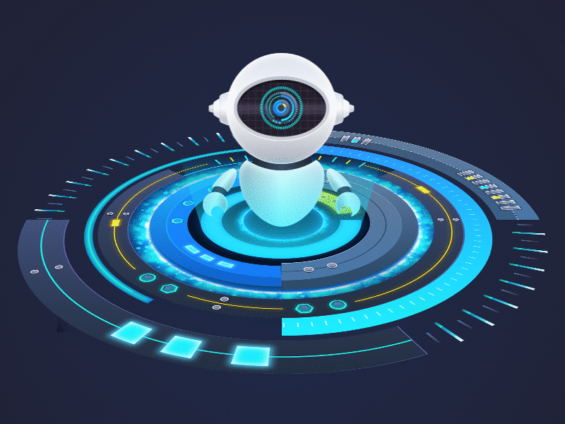

# BUAI — Indie Developer & AI Product Builder

  
  <h1>
    
  </h1>

---

  <h2>🚀 About Me</h2>
  
Hi, I'm <strong>BUAI</strong> — an independent developer and product builder.

  
I create web products at the intersection of <strong>AI, creative tools, and daily games</strong>.

  
My focus is on turning useful ideas into real products — from AI video generation to browser-based games and developer resources.

  
I enjoy building, experimenting, and refining products based on real user feedback. Explore my work below.

## 🚀 Products & Websites

I build and maintain independent products across **AI video**, **daily games**, and **developer tools**. Below are the live projects and resources I'm working on.

### 🎬 AI Video & Creative Tools

- **[AIFree Video](https://aifree.video/)** — AI video creation and generation tools.
- **[Wan2.Video](https://wan2.video/)** — AI video generators, models, and creative workflows.
- **[CDance AI](https://cdanceai.com/)** — AI video creation.
- **[AudioVizFree](https://audiovizfree.com/)** — Audio visualization tools.

### 🎮 Daily Games & Discovery

- **[DLE Games](https://dlegames.org/)** — Discover daily browser games, Wordle alternatives, and puzzles.
- **[Visual Novel Games](https://visualnovelgames.net/)** — Explore visual novel games.

### 🛠️ AI & Developer Tools

- **[AI IDE List](https://aiidelist.com/)** — Compare AI IDEs, coding agents, and developer tools.
- **[ImageToolkit](https://imagetoolkit.org/)** — Free browser-based image tools.
- **[A2A MCP](https://a2a-mcp.org/)** — Discover MCP servers and agent integrations.
- **[OKLCH](https://oklch.xyz/)** — Explore and create colors with OKLCH.
- **[Free3DGen](https://free3dgen.com/)** — AI-powered 3D creation tools.
- **[Frequency Test](https://frequencytest.org/)** — Browser-based frequency and audio testing.
- **[Dead Pixel Check](https://dead-pixel-check.com/)** — Screen and dead-pixel testing.

### 📦 Open-source & GitHub Projects

- [Daily Puzzle Kit](https://github.com/buainoai/daily-puzzle-kit) — TypeScript utilities for building daily puzzle games.
- [DLE Games Community](https://github.com/buainoai/dlegames) — game submissions, data examples, and project documentation.
- [Remotion Skills](https://github.com/buainoai/remotion-skills)
- [Awesome AI Pricing](https://github.com/buainoai/awesome-ai-pricing)
- [Awesome AI Devtools Multilingual](https://github.com/buainoai/awesome-ai-devtools-multilingual)
- [Next.js Cloudflare Migration Skills](https://github.com/buainoai/nextjs-cloudflare-migration-skills)

---

  <h2>🧠 Core Competencies</h2>
  
Technologies and tools I explore and work with:

   
  

---

  <h2>🌐 My Philosophy</h2>
  <blockquote>
    
“AI is most valuable when it amplifies human creativity and capability. The goal is to turn powerful technology into practical tools that help people create, learn, and solve problems.”

  </blockquote>

